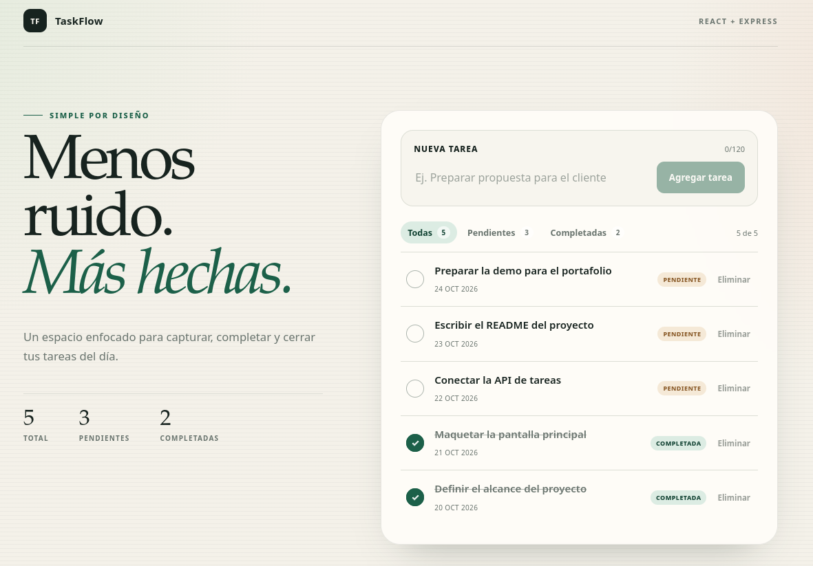
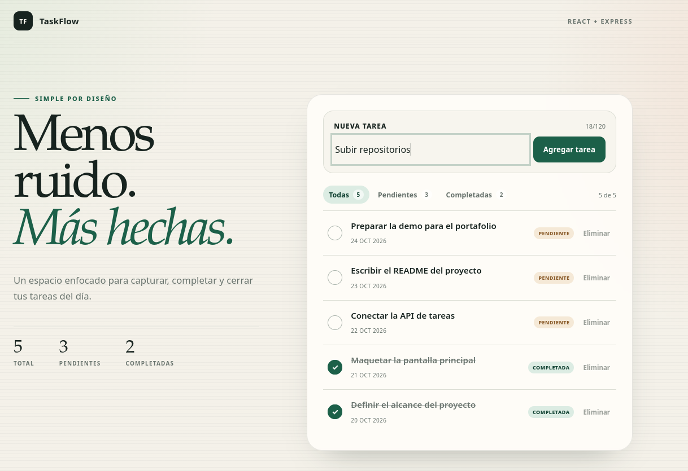
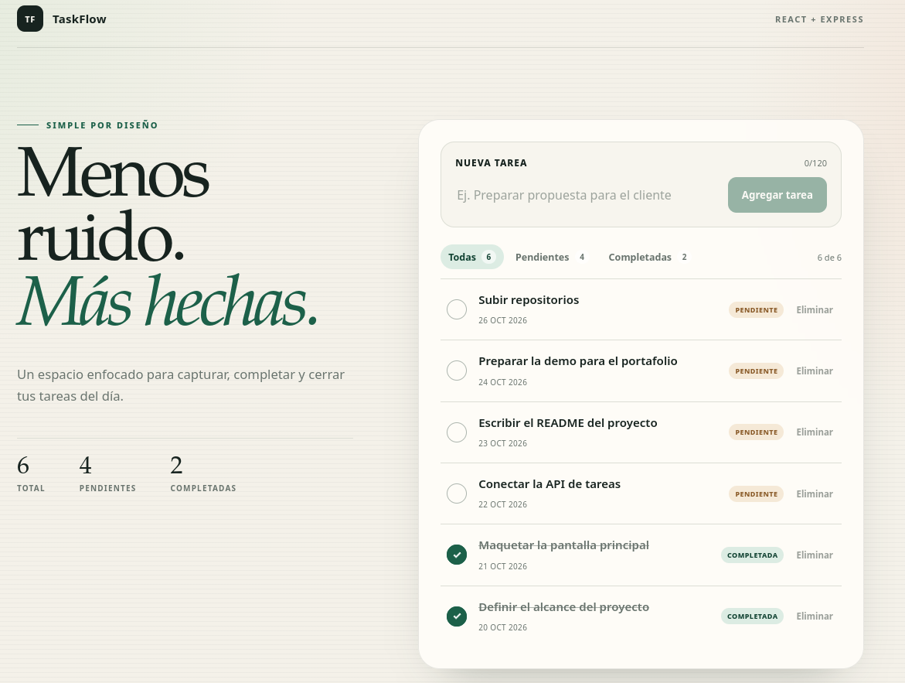

# TaskFlow

Gestor de tareas simple para portafolio. React 18 + Vite + TypeScript en el cliente, Express + TypeScript en la API y persistencia en un archivo JSON local. Sin autenticación, base de datos externa ni variables secretas.

## Stack

- **Frontend:** React 18, Vite, TypeScript, CSS puro.
- **Backend:** Node.js, Express, TypeScript.
- **Persistencia:** `server/data/tasks.json` con seed automático de 5 tareas.

## Requisitos

- Node.js 20.19 o superior (o 22.12+).
- npm.

## Correr en local

Terminal 1 — API:

```bash
cd server
npm install
cp .env.example .env
npm run dev
```

API en `http://localhost:3001`.

Terminal 2 — UI:

```bash
cd client
npm install
cp .env.example .env
npm run dev
```

UI en `http://localhost:5173`.

> El cliente usa `VITE_API_URL` desde `.env`. Si se elimina esa variable, Vite usa el proxy `/api` hacia el puerto 3001.

## Scripts

| Carpeta | Script | Acción |
| --- | --- | --- |
| `client` | `npm run dev` | Inicia Vite en el puerto 5173 |
| `client` | `npm run build` | Typecheck y build de producción |
| `client` | `npm run preview` | Sirve el build localmente |
| `server` | `npm run dev` | Inicia la API con recarga en caliente |
| `server` | `npm run build` | Compila TypeScript a `dist/` |
| `server` | `npm start` | Ejecuta la API compilada |

## Endpoints

Base: `http://localhost:3001`

| Método | Ruta | Descripción | Respuesta |
| --- | --- | --- | --- |
| `GET` | `/api/health` | Estado de la API | `200` |
| `GET` | `/api/tasks` | Lista todas las tareas | `200` |
| `POST` | `/api/tasks` | Crea una tarea | `201` |
| `PATCH` | `/api/tasks/:id` | Actualiza título y/o estado | `200` |
| `DELETE` | `/api/tasks/:id` | Elimina una tarea | `204` |

Ejemplos:

```bash
curl http://localhost:3001/api/tasks

curl -X POST http://localhost:3001/api/tasks \
  -H "Content-Type: application/json" \
  -d '{"title":"Nueva tarea"}'

curl -X PATCH http://localhost:3001/api/tasks/ID \
  -H "Content-Type: application/json" \
  -d '{"status":"done"}'

curl -X DELETE http://localhost:3001/api/tasks/ID
```

Validación: `title` obligatorio, máximo 120 caracteres; `status` solo `pending` o `done`. Los errores devuelven `{ "error": "..." }`.

## Persistencia

- Archivo: `server/data/tasks.json`.
- Si no existe, el servidor lo crea con 5 tareas de ejemplo al arrancar.
- Las escrituras son atómicas mediante archivo temporal y `rename`.
- Para reiniciar la demo, elimina `server/data/tasks.json` y reinicia la API.

En un host con sistema de archivos efímero (por ejemplo, el plan gratuito de Render), los cambios se pierden al reiniciar o redeployar. Para una demo persistente, configura un disco persistente o reemplaza el store por una base de datos.

## Deploy sugerido

### Backend en Render

- Root directory: `server`
- Build command: `npm install && npm run build`
- Start command: `npm start`
- Variables:
  - `CLIENT_ORIGIN=https://tu-frontend.vercel.app`
  - `PORT` lo define Render automáticamente.
- Health check: `/api/health`

### Frontend en Vercel

- Root directory: `client`
- Framework preset: Vite
- Build command: `npm run build`
- Output directory: `dist`
- Variable: `VITE_API_URL=https://tu-api.onrender.com`

## Screenshots




